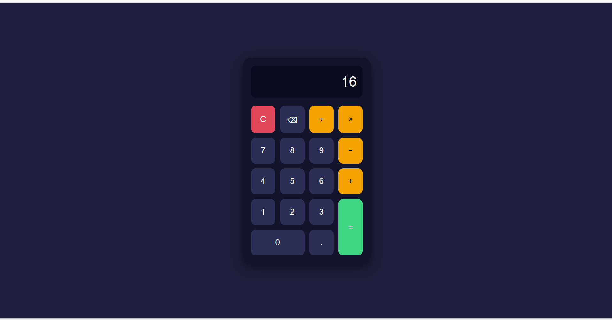
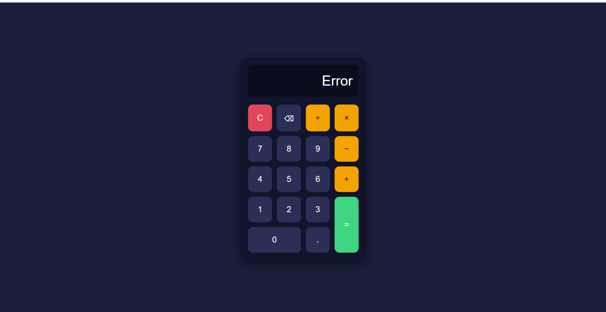
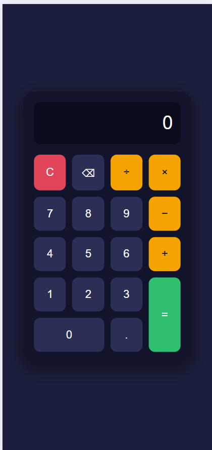

# Calculator

A browser-based calculator built for the **Oasis Infobyte Web Development & Designing internship** (Level 2, Task 1: Calculator).

**Author:** Rinaz Pathan

## Features

- Display screen showing the current input and result
- Number buttons (0-9) and a decimal point
- Operators: addition, subtraction, multiplication and division
- Equals button to evaluate the expression
- Clear (C) button to reset the display
- Backspace button to delete the last entered character
- Division by zero shows an error message instead of crashing
- Operator chaining: sequential operations (for example 5 + 3 × 2) work without a reset, evaluated left to right
- Rounding fix so results like 0.1 + 0.2 display as 0.3
- Button layout built with CSS Grid
- All buttons use JavaScript event listeners (no inline onclick) and the logic is written by hand without eval()

## Tech Stack

- HTML5
- CSS3 (CSS Grid)
- JavaScript (Vanilla)

## Project Structure

```
WebDev-L2-Calculator/
├── screenshots/
├── index.html
├── style.css
├── script.js
└── README.md
```

## How to Run

1. Clone the repository or download the folder.
2. Open `index.html` in any web browser.

## Screenshots

### Calculation


### Division by Zero Error


### Mobile View
