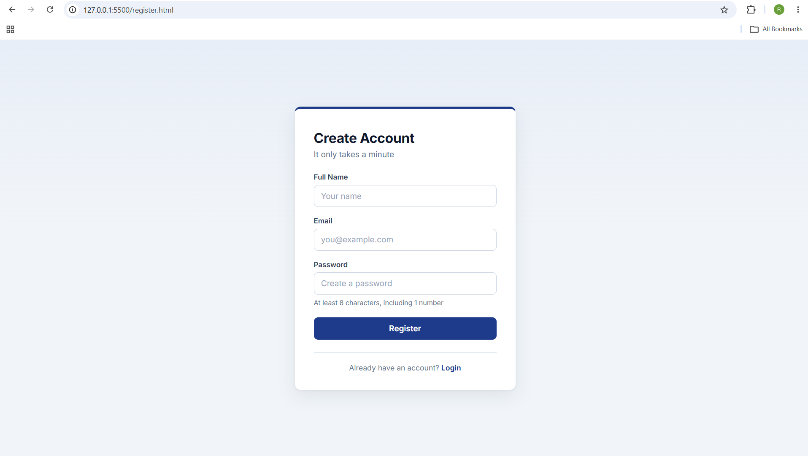
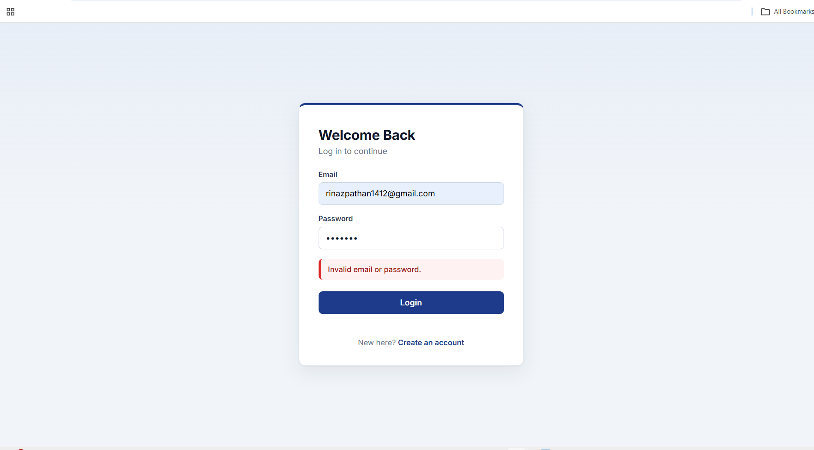
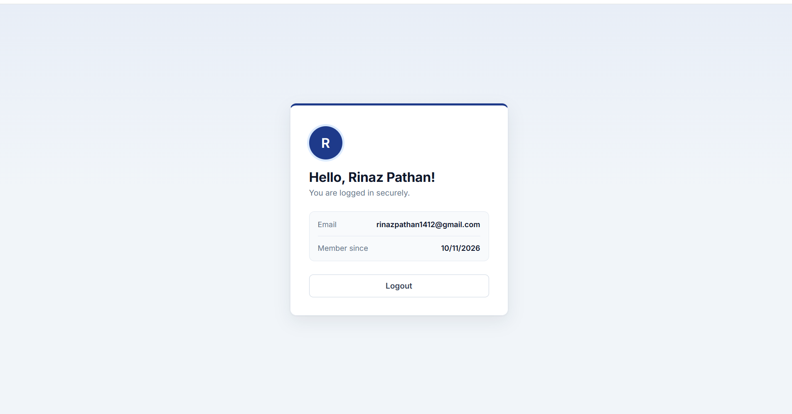
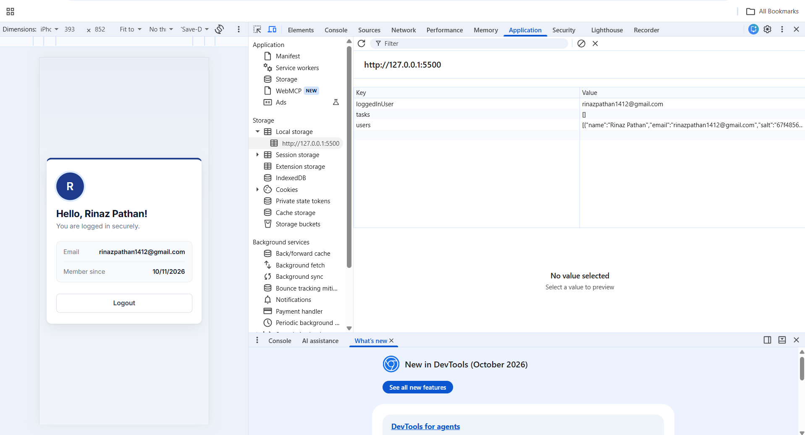
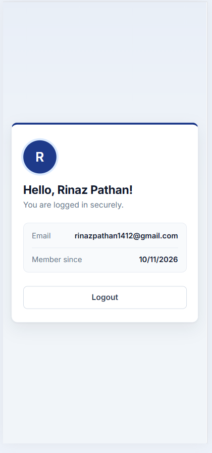

# Login Authentication System

A client-side user authentication system built for the **Oasis Infobyte Web Development & Designing internship** (Level 2, Task 4: Login Authentication System).

**Author:** Rinaz Pathan

## Approach

I used **Approach A: front-end only** (HTML, CSS and JavaScript with localStorage). There is no backend server.

## Features

- **Registration page** with name, email and password fields
- **Password rules:** minimum 8 characters and at least 1 number
- **Duplicate check:** an error appears if the email is already registered
- **Login page** with a generic error message ("Invalid email or password.") that does not reveal which field was wrong
- **Protected dashboard:** opening `dashboard.html` without logging in redirects to the login page
- **Logout** button that clears the session and returns to the login page
- **Password hashing:** passwords are never stored in plain text. Each password is combined with a random salt and hashed with SHA-256 using the browser's Web Crypto API
- **Form validation:** empty submissions are rejected on both pages
- Clean, responsive, professional design

## Tech Stack

- HTML5
- CSS3
- JavaScript (Vanilla, Web Crypto API, localStorage)
- Google Fonts (Inter)

## How It Works

1. On registration, a random salt is generated and the password is hashed with SHA-256. Only the salt and hash are saved in localStorage, with the user's name, email and join date.
2. On login, the entered password is hashed with the stored salt and compared to the saved hash.
3. After a successful login, the user's email is saved as the session. The dashboard checks this on load and redirects to the login page if no session exists.
4. Logout removes the session.

## Project Structure

```
WebDev-L2-LoginAuth/
├── screenshots/
├── index.html        (login page)
├── register.html
├── dashboard.html
├── style.css
├── auth.js           (shared helper functions)
├── login.js
├── register.js
├── dashboard.js
└── README.md
```

## How to Run

1. Clone the repository or download the folder.
2. Open the folder in VS Code and start it with the **Live Server** extension, or open `index.html` in a browser.
3. Register a new account, then log in.

## Security Note

This project is for learning. Because everything runs in the browser, anyone can inspect localStorage with developer tools. A real application must verify passwords on a server and use a slow, purpose-built hashing algorithm such as bcrypt.

## Screenshots

### Registration Validation


### Login Error


### Dashboard


### Hashed Password in localStorage


### Mobile View


## Credits

- Fonts: [Google Fonts](https://fonts.google.com/)
- All code and design written by me for this internship task.