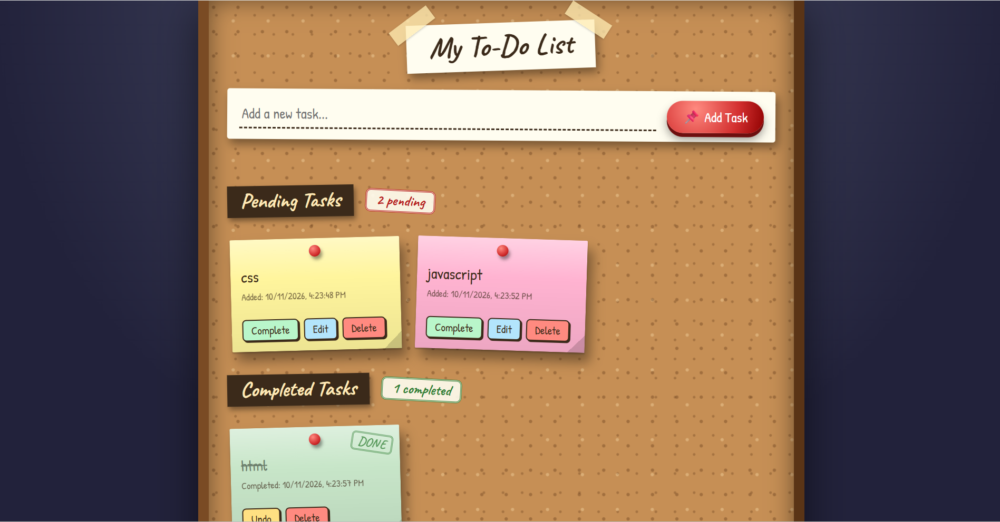
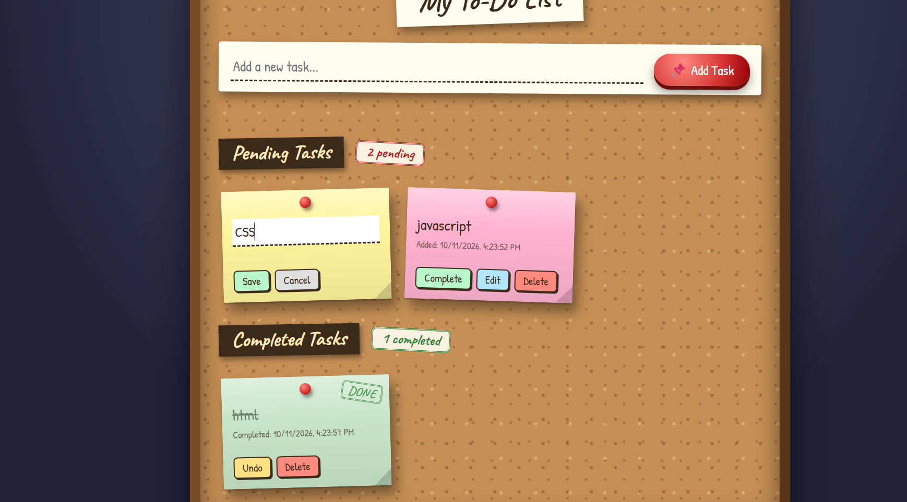
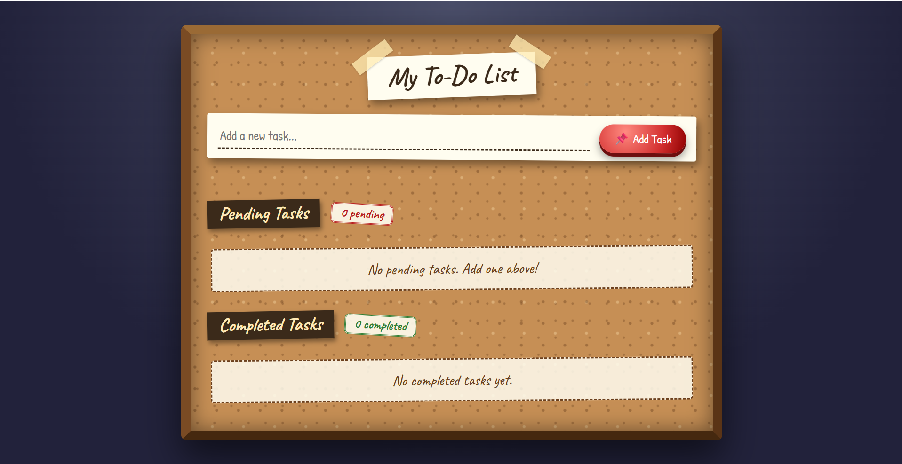
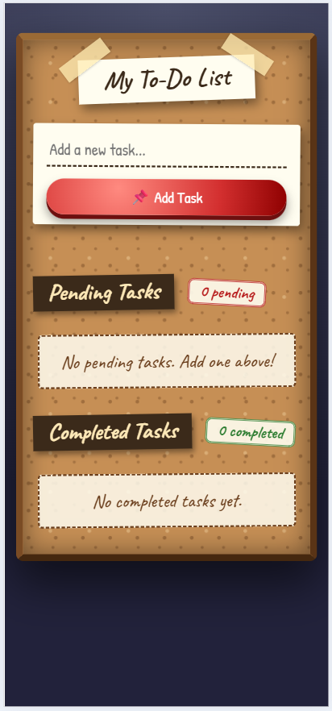

# To-Do Web App

An interactive to-do list built for the **Oasis Infobyte Web Development & Designing internship** (Level 2, Task 3: To-Do Web App). Tasks appear as sticky notes pinned to a cork board.

**Author:** Rinaz Pathan

## Features

- Input field and **Add Task** button (pressing Enter also adds a task)
- New tasks appear immediately in the **Pending Tasks** list
- **Complete** button moves a task to the **Completed Tasks** list, and **Undo** moves it back
- **Edit** button changes the task text inline (Enter saves, Escape cancels)
- **Delete** button permanently removes a task from either list
- Live counters: "X pending" and "Y completed" above each list
- Friendly empty-state messages when a list has no items
- Input validation: an error message appears if the task is empty
- **Bonus:** timestamp showing when each task was added and completed
- **Bonus:** tasks are saved with localStorage, so they stay after a page refresh
- Cork board design with 3D-style sticky notes, built entirely with CSS
- Responsive layout for desktop and mobile

## Tech Stack

- HTML5
- CSS3 (Grid, gradients, transforms, shadows, media queries)
- JavaScript (Vanilla, DOM manipulation, localStorage)
- Google Fonts (Caveat and Patrick Hand)

## How It Works

All tasks are stored in a JavaScript array. Whenever a task is added, completed, edited or deleted, the array is updated and saved to localStorage. Then both lists are redrawn from the array, which keeps the screen and the saved data consistent.

## Project Structure

```
WebDev-L2-ToDoApp/
├── screenshots/
├── index.html
├── style.css
├── script.js
└── README.md
```

## How to Run

1. Clone the repository or download the folder.
2. Open `index.html` in any web browser.
3. An internet connection is needed once to load the Google Fonts.

## Screenshots

### Pending and Completed Tasks


### Inline Editing


### Empty State


### Mobile View


## Credits

- Fonts: [Google Fonts](https://fonts.google.com/)
- All code and design written by me for this internship task.