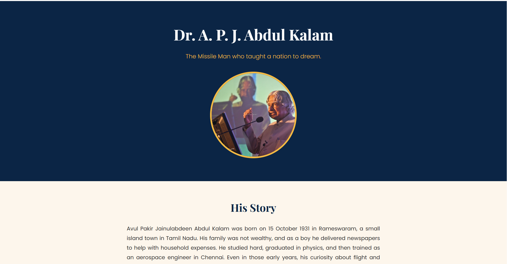
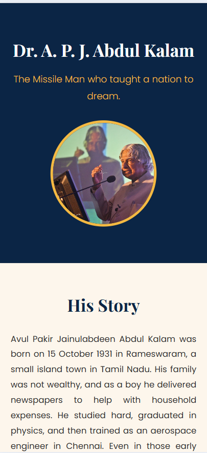

# Tribute Page: Dr. A. P. J. Abdul Kalam

A responsive tribute page dedicated to Dr. A. P. J. Abdul Kalam, built as part of the **Oasis Infobyte Web Development & Designing internship** (Level 2, Task 2: Tribute Page).

**Author:** Rinaz Pathan

## Features

- Hero section with the subject's name, a one-line tagline and a portrait image
- Biography section with four paragraphs
- Timeline of key milestones, built with an ordered list
- Distinctly styled quote block
- Multiple background colours across sections (navy, cream, light blue, gold)
- Two font families: Playfair Display (serif) for headings and Poppins (sans-serif) for body text
- Fully responsive layout for desktop and mobile screens

## Tech Stack

- HTML5
- CSS3 (Flexbox-free, media queries for responsiveness)
- Google Fonts

## Project Structure

```
WebDev-L2-TributePage/
├── images/
├── screenshots/
├── index.html
├── style.css
└── README.md
```

## How to Run

1. Clone the repository or download the folder.
2. Open `index.html` in any web browser.

## Screenshots

### Desktop View


### Mobile View


## Credits

- Portrait: "APJ Abdul Kalam" by Pushkarv, licensed under [CC BY 3.0](https://creativecommons.org/licenses/by/3.0/), via [Wikimedia Commons](https://commons.wikimedia.org/wiki/File:APJ_Abdul_Kalam.jpg). Cropped to a circle.
- Biography text written in my own words, with facts checked against Britannica.
- Fonts: [Google Fonts](https://fonts.google.com/)